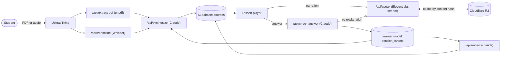

# Lyceo

**The tutor that learns how you learn.**

Lyceo turns a student's own lecture slides or class recordings into a lesson that an AI tutor, Theo, teaches out loud on a chalkboard. After each part Theo asks one check-in question, grades the idea rather than the wording, and when the answer is wrong he explains it again from a different angle. Every answer feeds a learner model, so the next lesson is written for that student: examples from their major, explanations in the style they prefer, smaller steps where they've been struggling, and review lessons built from exactly what they missed.

**[Try the 5-minute demo lesson on Bayes' theorem](https://eduai-wine.vercel.app/demo)** (no account needed).

<!-- Add a 30-second screen recording here: docs/demo.gif -->

## What it does

1. **Upload** a PDF of the slides or an audio recording of the class.
2. **Lesson generation.** Text is extracted (unpdf) or transcribed (Whisper), and Claude writes a structured lesson: for each part, a spoken narration, 2 to 5 chalkboard lines with LaTeX, and a check question with an ideal answer. The output is schema-validated with Zod.
3. **The lesson.** Theo's voice (ElevenLabs) streams while the board writes itself line by line, in sync with the audio. Formulas render with KaTeX.
4. **Check-ins.** Claude grades each answer for understanding. A wrong answer triggers a re-explanation with a new board and new audio, using a different teaching approach than the first one.
5. **Review.** At the end, the student can generate a short review lesson that covers only the parts they missed, written around their actual wrong answers.

## How the personalization works

Every check-in answer is stored in `session_events`. For each concept a student has seen, the learner model computes:

- **First-try correctness:** did they get it without a re-explanation? Concepts missed on the first try go into "Worth reviewing".
- **Mastery:** a Laplace-smoothed success rate, `(correct + 1) / (attempts + 2)`, so one lucky or unlucky answer doesn't dominate.
- **Pace:** first-try accuracy over the last 20 concepts sets the pace of the next lesson. Below 55% means smaller steps and 6 to 8 parts; above 85% (after at least 5 concepts) means a brisk lesson with harder transfer questions.

Those signals, plus the student's major and preferred learning style from their profile, go into the prompt that writes the next lesson (`app/lib/server/ai.ts`). The lesson stores what it was tailored for and shows it to the student, and the dashboard shows the learner model itself.

## Architecture



Some details that matter:

- **Audio latency.** `/api/speak` streams ElevenLabs audio to the browser as it's generated and tees a copy into R2 in the background (`after()`), so playback starts in about a second and every sentence is generated once. Audio is cached by a SHA-256 of voice, model and text. While one part plays, the player downloads the next part's audio, so moving on is instant.
- **No open endpoints for paid APIs.** Speech URLs are HMAC-signed by the server, the demo can only sign its own narration, and grading in the demo only accepts the demo's own questions.
- **Auth everywhere.** API routes verify the Supabase session from the `Authorization` header and query as that user, so row-level security applies. Uploads require a session too, and the server only downloads files hosted by UploadThing.
- **Backward compatible.** Lessons written by the earlier Spanish version (StudyAI) are converted on read.

## Unit economics

Estimated from token and character counts at list prices (November 2026): Claude Sonnet 4.6 at $3 / $15 per million input / output tokens, and ElevenLabs Multilingual v2 at about $0.10 per 1,000 characters.

| Step | Typical size | Cost |
| --- | --- | --- |
| Write a lesson | ~5k input and ~1.6k output tokens | ~$0.04 |
| Narration audio | ~4,000 characters | ~$0.40 |
| Grade 5 check-ins | ~1.1k input and ~250 output tokens each | ~$0.03 |
| **New lesson total** | | **~$0.47** |
| Each re-explanation | ~550 characters of audio | ~$0.05 |
| Replaying a lesson | served from the R2 cache | ~$0 |

Audio is about 85% of the cost. Setting `ELEVENLABS_MODEL_ID=eleven_flash_v2_5` halves it, at some cost in voice quality. Transcribing a recording with Whisper adds about $0.006 per minute.

## Stack

Next.js 16 (App Router) and React 19, TypeScript, Tailwind CSS 4, Supabase (Google auth and Postgres), Claude Sonnet 4.6 through the Vercel AI SDK, OpenAI Whisper, ElevenLabs, Cloudflare R2, UploadThing, KaTeX. Deployed on Vercel.

## Running it locally

```bash
npm install
cp .env.example .env.local   # fill in the keys
npm run dev
```

In Supabase, enable Google sign-in and add both `http://localhost:3000/**` and your production URL under **Authentication → URL Configuration → Redirect URLs**.

Tables the app uses:

```sql
create table users (
  id uuid primary key references auth.users,
  email text,
  name text,
  career text,          -- the student's major
  learning_style text   -- analogias | formal | codigo | visual
);

create table courses (
  id bigint generated always as identity primary key,
  user_id uuid references auth.users not null,
  title text,
  description text,
  status text,          -- extracted | ready | failed
  script jsonb,         -- the lesson
  created_at timestamptz default now()
);

create table session_events (
  id bigint generated always as identity primary key,
  user_id uuid references auth.users not null,
  course_id bigint references courses on delete cascade,
  segment_index int,
  question text,
  answer text,
  correct boolean,
  time_to_answer_seconds int,
  created_at timestamptz default now()
);
```

## What's next

- Answer check-ins out loud (the Whisper pipeline is already there).
- Evals for the tutor: a fixed set of materials and student answers, scored for grading accuracy and explanation quality, run on every prompt change.
- A fully animated Theo and richer board drawings (graphs, diagrams).
- Shared lessons per course, so a class's slides are taught once and the audio is reused across students.
- Mobile app, payments.

## Author

Built by José Miguel Féliz, Williams College '28. [LinkedIn](https://www.linkedin.com/in/jose-feliz-cuevas/)
